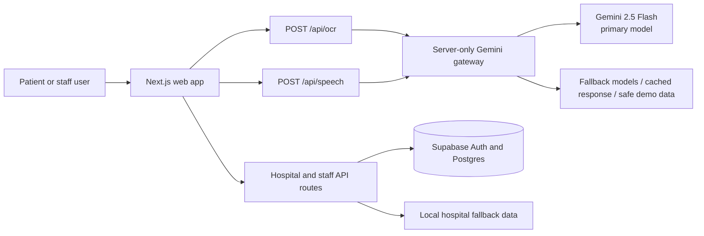

# ShifaAI (شفا)

<p align="center">
  
</p>

<p align="center"><strong>Prescription guidance and care-capacity navigation for patients, families, and emergency-care teams in Hyderabad, Sindh.</strong></p>

<p align="center">
  <a href="https://nextjs.org/">Next.js 16</a> · <a href="https://react.dev/">React 19</a> · <a href="https://supabase.com/">Supabase</a> · <a href="https://ai.google.dev/">Gemini</a> · <a href="LICENSE">MIT License</a>
</p>

> Status: this is a hackathon prototype. Prescription guidance and hospital availability must always be verified by qualified clinical staff and the receiving hospital.

## What it does

ShifaAI turns a handwritten prescription image into a structured medication guide, including English, Urdu, and Sindhi text and spoken guidance. It also presents a Hyderabad care-capacity dashboard with hospital filters, map views, referral holds, and role-based staff workspaces.

The application remains usable when Gemini or Supabase is unavailable: OCR falls back to a clearly marked clinical demo scenario and hospital data falls back to local sample data.

## Features

- Prescription image upload or camera capture with schema-constrained Gemini OCR.
- Urdu RTL layout with Noto Nastaliq Urdu; English, Urdu, and Sindhi UI translations.
- Gemini-backed Urdu/Sindhi speech where available, with browser speech fallback.
- Gemini key rotation, retry/backoff, cooldowns, request de-duplication, per-process cache, and a safe UI fallback.
- Hospital capacity filters, triage ranking, Leaflet map, and 45-minute referral-hold flow.
- Supabase Auth staff portal with Admin, Coordinator, and Staff roles.
- Judge/demo mode and local fallbacks for a resilient demonstration.

## Architecture



## Tech stack

| Layer | Technology | Purpose |
| --- | --- | --- |
| Web app | Next.js 16, React 19, TypeScript | App Router application and API routes |
| UI | Tailwind CSS, Lucide, Leaflet | Responsive UI, icons, and hospital map |
| Data and auth | Supabase, `@supabase/ssr` | PostgreSQL, authentication, and role-based access |
| AI | Gemini API | Prescription OCR and speech generation |
| Localisation | Noto Urdu/Arabic fonts, Web Speech API | English, Urdu, and Sindhi experience |

## Project structure

```text
src/
  app/                 # Pages, layouts, and API route handlers
  components/          # Prescription, bed-grid, map, telemetry, and UI components
  lib/
    gemini.ts          # Server-only Gemini gateway and health checks
    supabase/          # Browser, server, and proxy Supabase clients
    triage/            # Hospital ranking logic
    data/              # Local hospital and prescription fallbacks
  types/               # Shared TypeScript types
supabase/migrations/   # PostgreSQL schema and RLS policies
scripts/               # Demo seeding and Gemini key checks
docs/screenshots/      # Optional screenshot capture guide
```

## Getting started

### Prerequisites

- Node.js 20 or newer (the connected Vercel project currently uses Node 24).
- npm.
- Optional: a Supabase project and Gemini API key(s) for live integrations.

### Install and run

```bash
git clone https://github.com/mokashkumar1/shifa-ai.git
cd shifa-ai
npm install
```

Create a local environment file:

```powershell
Copy-Item .env.example .env.local
```

```bash
npm run dev
```

Open `http://localhost:3000`.

### Environment variables

| Variable | Required | Description |
| --- | --- | --- |
| `NEXT_PUBLIC_SUPABASE_URL` | For live Supabase | Supabase project URL. |
| `NEXT_PUBLIC_SUPABASE_ANON_KEY` | For live Supabase | Browser-safe Supabase anonymous key. |
| `SUPABASE_SERVICE_ROLE_KEY` | For demo seeding/admin actions | Server-only Supabase service-role key. |
| `GEMINI_API_KEYS` | For live Gemini | Comma-separated server-only Gemini keys. |
| `GEMINI_API_KEY` | Optional legacy fallback | One server-only Gemini key when `GEMINI_API_KEYS` is absent. |
| `GEMINI_MODELS` | Optional | Ordered main-generation model fallback chain. Defaults to Gemini 2.5 Flash first. |
| `NEXT_PUBLIC_APP_URL` | Optional | Public application URL; `http://localhost:3000` locally. |
| `DEMO_MODE` | Optional | Enables demo seeding when server credentials are present. |
| `NEXT_PUBLIC_DEMO_MODE` | Optional | Enables the demo-mode UI. |

Never prefix Gemini keys with `NEXT_PUBLIC_`.

### Database setup

For live Supabase features, run these migrations in the Supabase SQL editor in order:

1. `supabase/migrations/20261023_init_bedgrid.sql`
2. `supabase/migrations/20261023_staff_access.sql`

Then seed demo accounts when the required server environment variables are configured:

```bash
npm run seed:demo
```

## Quality checks

```bash
npm run lint
npm run build
npm run check-keys
```

`check-keys` loads `.env.local`, checks each configured Gemini key, and prints only masked key identifiers. The health route provides a deployment-safe status check:

```text
GET /api/health
```

It returns the number of loaded and healthy keys, active model, and ping status. It never returns key values.

## API overview

| Route | Method | Purpose |
| --- | --- | --- |
| `/api/health` | GET | Gemini key/model health summary. |
| `/api/ocr` | POST | Analyses a prescription image submitted as multipart `image`; accepts optional `language`. |
| `/api/speech` | POST | Produces speech from `{ text, lang }`. |
| `/api/hospitals` | GET | Returns Supabase hospital data or local fallback data. |
| `/api/referral-holds` | POST | Creates a referral hold for authorised roles. |
| `/api/staff/data` | GET/PATCH | Reads or updates role-scoped staff data. |
| `/api/staff/signup` | POST | Creates a staff sign-up request. |

Example OCR request:

```bash
curl -X POST http://localhost:3000/api/ocr -F "image=@prescription.jpg" -F "language=ur"
```

## Deployment on Vercel

The repository is connected to Vercel as `mokashs-projects/dinning-hyd`.

1. Push `main` to GitHub.
2. In **Vercel → Settings → Environment Variables**, add the variables from `.env.example`.
3. Add real values for production, preview, and development as needed. Gemini keys must stay server-only.
4. Deploy and open `/api/health` to confirm key status.

## Screenshots

The repository includes a capture guide in [docs/screenshots/README.md](docs/screenshots/README.md). Add real screenshots to that folder before linking them from this README.

## Contributing

1. Create a branch from `main`.
2. Keep changes focused and avoid committing `.env` files or keys.
3. Run `npm run lint` and `npm run build`.
4. Open a pull request that explains the user-facing change and verification performed.

## License

MIT © 2026 Mokash Kumar. See [LICENSE](LICENSE).

## To verify manually

- Add the real production URL here once it is confirmed: `<!-- TODO: add production URL -->`.
- Add real screenshots only after capturing them from the deployed application.
- Confirm actual hospital-capacity data with participating hospitals before presenting it as live operational data.
